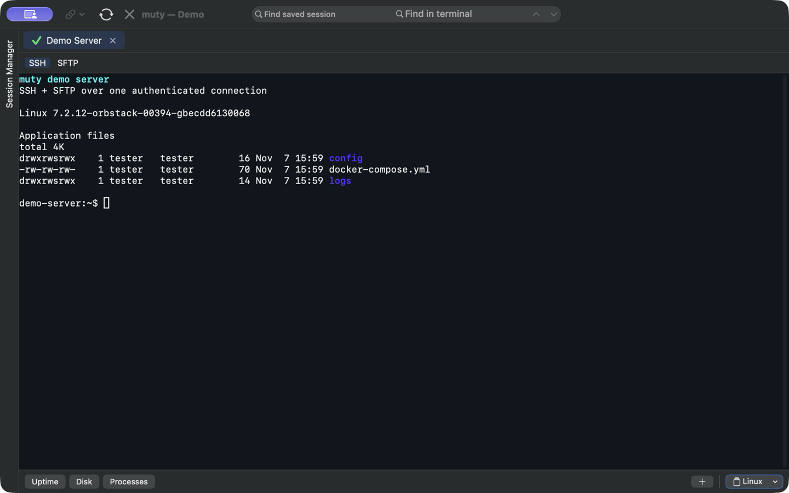
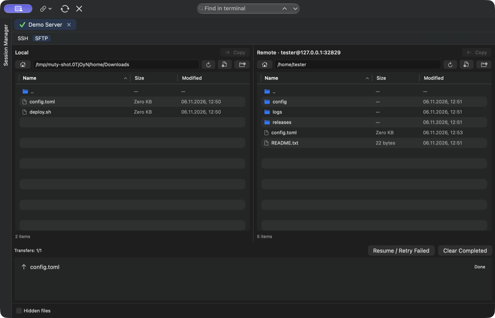

# muty

Native SSH and SFTP client for macOS. Built with SwiftUI and SwiftTerm, powered by macOS OpenSSH. No account or cloud service required.



- SSH and local shell tabs with split layouts.
- Two-pane SFTP browser, transfer queue and tabbed remote text editor.
- Saved sessions, folders, shared credentials and quick session search in the toolbar.
- Jump hosts, port forwarding and tunnel-only sessions.
- SecureCRT and MobaXterm session import.
- Local credential vault and encrypted backups.



*Screenshots show an earlier release.*

## Sessions and remote files

Use **Find saved session** next to the terminal search field to find saved sessions by name or host address. Choose a suggestion with the arrow keys and press Enter, or click it, to open a new connection. Folder names are shown for context but are not included in the search. The Session Manager uses the same search rules.

Remote files open as tabs in one editor window per SFTP session. Long lines wrap to fit the window; Tab inserts spaces in YAML files. Escape closes the current editor or viewer tab, with a confirmation for unsaved changes. If a file has changed on the server, saving is refused and your unsaved text stays in the open tab.

Use **Clear Completed** to remove completed transfers; the transfer panel disappears when the queue is empty. The button-set selector is on the right of the Button Bar, after the **+** button.

## Download

muty requires Apple silicon (arm64) and macOS 14 or later. Download the app ZIP from the [latest GitHub release](https://github.com/degritsenko/muty/releases/latest), unzip it, and move `muty.app` to Applications.

The app is ad-hoc signed and has not been notarized. If macOS blocks the app and you trust the download, go to **System Settings → Privacy & Security → Open Anyway** after the first launch attempt and confirm. macOS saves an exception for muty. [Apple Support](https://support.apple.com/en-us/102445)

## Build from source

Requires macOS 14 or later and an Xcode toolchain with Swift 6.0 or later. Clone this repository and run the following commands from its root.

```sh
bash scripts/build-app.sh
open dist/muty.app
```

See [Contributing](CONTRIBUTING.md) for development and testing, [Security](SECURITY.md) for vulnerability reporting, and [Privacy](PRIVACY.md) for local data handling.

## Host keys

muty keeps trusted server keys in `~/Library/Application Support/muty/known_hosts`, using the OpenSSH file format. SSH sessions and jump hosts use this file; SFTP reuses the verified SSH connection. User and system OpenSSH host-key files are not consulted automatically.


Original code is licensed under [Apache-2.0](LICENSE). See [third-party notices](THIRD_PARTY_NOTICES.md).
