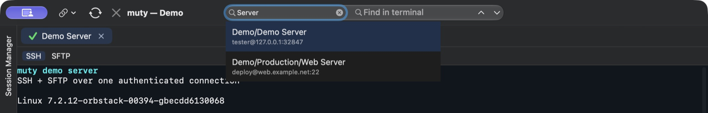

# muty

Native SSH and SFTP client for macOS. Built with SwiftUI and SwiftTerm, powered by macOS OpenSSH. No account or cloud service required.


- SSH and local shell tabs with split layouts.
- Per-session terminal themes with inheritance from Settings. Bulk Edit supports session colors and terminal themes for SSH and Local Shell sessions.
- Keyword highlighting in terminal output: matched words change foreground colour only. Enabled by default; configure rules in Settings → Syntax Highlighting or toggle with View → Highlight Output (⇧⌘H).
- Two-pane SFTP browser, transfer queue and tabbed remote text editor.
- Saved sessions, folders, shared credentials and quick session search in the toolbar.
- Jump hosts, port forwarding and tunnel-only sessions.
- SecureCRT and MobaXterm session import.
- Local credential vault and encrypted backups. Forget saved passwords for selected SSH sessions through Bulk Edit, including unlinking shared credentials.
- Open session settings directly from a tab, including temporary connections. Inspect remote SFTP file properties and edit Unix permissions.
- Color Session Manager folders with the session palette. Nested folders inherit their nearest colored parent unless assigned their own color.
- The Session Manager and terminal search fields use the same toolbar font size.


## Sessions and remote files

Use **Find saved session** next to the terminal search field to find saved sessions by name or host address. Choose a suggestion with the arrow keys and press Enter, or click it, to open a new connection. Search also matches folder paths such as `Prod/DB` or `Prod DB`, with session name and host matches ranked first. The Session Manager uses the same search rules and displays matching sessions in their folder tree. Pin it to keep it open alongside the terminal; unpinning hides it.



Remote files open as tabs in one editor window per SFTP session, with the server and file path displayed. Long lines wrap to fit the window; Tab inserts spaces in YAML files. Escape closes the current editor or viewer tab, with a confirmation for unsaved changes. If a file has changed on the server, saving is refused and your unsaved text stays in the open tab.

Completed SFTP transfers collapse to a summary. Use **Bookmarks** to save and reopen named pairs of local and remote directories for the current session and SSH destination. Use **Show** to reopen the list or **Clear** to remove completed, failed and cancelled transfers. **Pause** stops the current transfer between data blocks, **Resume** continues it, and **Cancel** interrupts it. Cancelled jobs can be retried with **Retry Failed**. You can hide the list during copying. Hidden files are always visible. The list opens automatically when a transfer fails. The button-set selector is on the right of the Button Bar, after the **+** button.

SSH/SFTP switching sits on the right of the compact session-tab row. Use ⌘1–9 to select a numbered session tab or Ctrl+Tab and Ctrl+Shift+Tab to cycle through tabs. The optional status bar shows the connection state, destination, negotiated SSH cipher and jump host; use **View → Status Bar** to show or hide it.

Open **File → Settings…** (⌘,) to configure muty. Quick Connect can use either a key from the library or a private-key file selected for that connection only. The source file is not copied or modified, and its permissions are checked before connecting.

In **Settings → General**, search for a startup session or choose what to open when no tabs are restored: an empty window, Local Shell or Quick Connect. Startup sessions connect automatically; other restored SSH tabs wait for Enter or Reconnect. Workspace restoration also restores the split layout and active pane for saved tabs.

Use **Import & Backup → Back Up… / Restore Backup…** for portable backups. Backup filenames include the local date. Operation logs remain open after completion, and restore confirmation summarizes the sessions, folders and passwords that will change. In **Settings → Credentials**, use the eye button in master-password dialogs to check your input, or **Disable Master Password…** to switch to automatic unlock.

## Download

muty requires Apple silicon (arm64) and macOS 14 or later. Download the app ZIP from the [latest GitHub release](https://github.com/degritsenko/muty/releases/latest), unzip it, and move `muty.app` to Applications.

The app is ad-hoc signed and has not been notarized. If macOS blocks the app and you trust the download, go to **System Settings → Privacy & Security → Open Anyway** after the first launch attempt and confirm. macOS saves an exception for muty. [Apple Support](https://support.apple.com/en-us/102445)

## Build from source

Requires macOS 14 or later and an Xcode toolchain with Swift 6.0 or later. Clone this repository and run the following commands from its root.

```sh
bash scripts/build-app.sh
open dist/muty.app
```

See [Contributing](CONTRIBUTING.md) for development and testing, [Security](SECURITY.md) for vulnerability reporting, and [Privacy](PRIVACY.md) for local data handling.

## Host keys

muty keeps trusted server keys in `~/Library/Application Support/muty/known_hosts`, using the OpenSSH file format. SSH sessions and jump hosts use this file; SFTP reuses the verified SSH connection. User and system OpenSSH host-key files are not consulted automatically.


Original code is licensed under [Apache-2.0](LICENSE). See [third-party notices](THIRD_PARTY_NOTICES.md).
