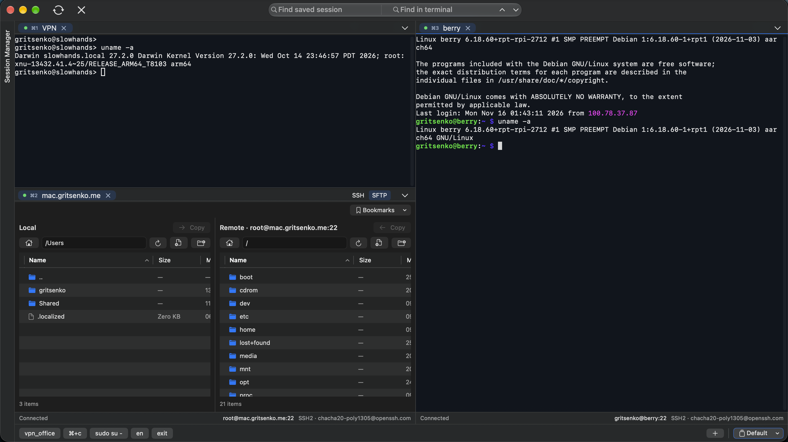

# muty

Native SSH and SFTP client for macOS. Built with SwiftUI and SwiftTerm, powered by macOS OpenSSH. No account or cloud service required.

- SSH and local shell tabs with split panes and independent tab groups.
- Two-pane SFTP browser with transfer queue, bookmarks and remote text editor.
- Saved sessions, folder colors, search, shared credentials and encrypted backups.
- Terminal themes, keyword highlighting and configurable Button Bar with folder inheritance and per-session assignments through Bulk Edit.
- Jump hosts, port forwarding and tunnel-only sessions.
- SSH key plus password authentication, external private-key selection and SFTP sudo mode.
- Import sessions from SecureCRT and MobaXterm.



## Download

muty requires Apple silicon (arm64) and macOS 14 or later. Download the app ZIP from the [latest GitHub release](https://github.com/degritsenko/muty/releases/latest), unzip it, and move `muty.app` to Applications.

The app is ad-hoc signed and has not been notarized. If macOS blocks the app and you trust the download, go to **System Settings → Privacy & Security → Open Anyway** after the first launch attempt and confirm. macOS saves an exception for muty. [Apple Support](https://support.apple.com/en-us/102445)

## Build from source

Requires macOS 14 or later and an Xcode toolchain with Swift 6.0 or later. Clone this repository and run the following commands from its root.

```sh
bash scripts/build-app.sh
open dist/muty.app
```

See [Contributing](CONTRIBUTING.md) for development and testing, [Security](SECURITY.md) for vulnerability reporting, and [Privacy](PRIVACY.md) for local data handling.

## Host keys

muty stores trusted server keys separately from OpenSSH in `~/Library/Application Support/muty/known_hosts`.


Original code is licensed under [Apache-2.0](LICENSE). See [third-party notices](THIRD_PARTY_NOTICES.md).
